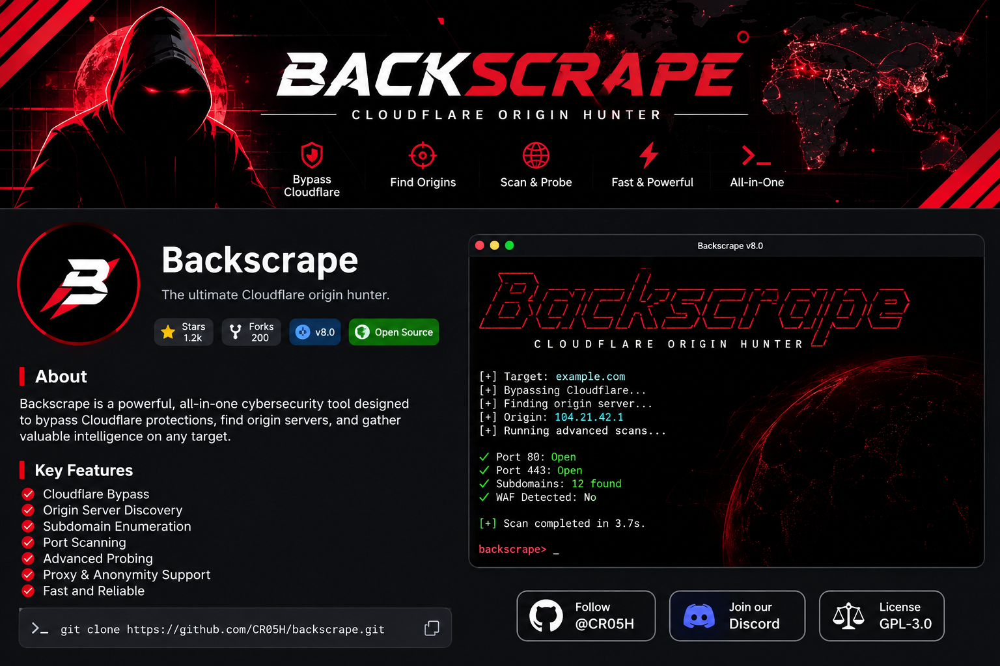
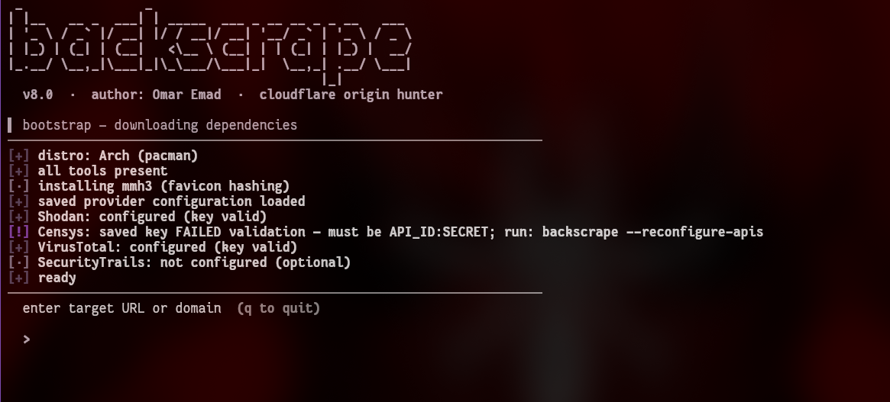

<p align="center">
  
</p>

<p align="center">
  </p>

<h1 align="center">Backscrape</h1>

<p align="center">
  Cloudflare Origin Research & Security Analysis
</p>

# backscrape

**Cloudflare origin hunter** — find the real server IP behind a Cloudflare-proxied
domain using 10+ passive sources, DNS brute force, and multi-signal verification
with a probability score.

> Author: **Omar Emad** · v8.0 · pure bash · no framework

## ⚠️ Legal disclaimer

This tool is for **authorized security testing and educational use only**.
You must own the target domain or have explicit written permission from the
owner. The author is **not responsible** for any misuse — full responsibility
lies with the user. See [DISCLAIMER.md](DISCLAIMER.md).

## Terminal Preview

<p align="center">
  
</p>

<p align="center">
  <i>Backscrape running in a Linux terminal.</i>
</p>

## What it does

| Phase | What happens |
|---|---|
| Wildcard check | Detects wildcard DNS so fake subdomains never pollute results |
| Passive collection | crt.sh, Cert Spotter, urlscan, HackerTarget, RapidDNS, Wayback, AlienVault OTX (all parallel) |
| Historical DNS | VirusTotal, SecurityTrails, ViewDNS, SPF records |
| Direct probes | origin, direct, dev, staging, api, panel, ... |
| Brute force | puredns + SecLists top-1M (optional) |
| AXFR | Zone-transfer attempts against every NS |
| Resolution | dnsx or parallel dig |
| Classification | Local Cloudflare IP-range matching + cached ASN lookup |
| Verification | 9 ports per host, multi-signal scoring: title, body similarity, favicon hash, cookies, server banner, TLS SAN, PTR, ASN |
| API intelligence | Shodan (3 query chains + favicon hash hunt), Censys (2 query chains) |

## Install
## 💬 Join the Community

Have questions, suggestions, or want to keep up with Backscrape?

<p align="center">
  <a href="https://discord.gg/yEHUQJXJS2">
    
  </a>
  &nbsp;
  <a href="https://discord.gg/yEHUQJXJS2">
    
  </a>
</p>
## Install

```bash
git clone https://github.com/CR05H/backscrape.git
cd backscrape
chmod +x backscrape.sh

# Optional: install globally
sudo cp backscrape.sh /usr/local/bin/backscrape

# Run directly
./backscrape.sh
```

## 💬 Join the Community

Have questions, suggestions, or want to keep up with Backscrape?

<p align="center">
  <a href="https://discord.gg/yEHUQJXJS2">
    
  </a>
  &nbsp;
  <a href="https://discord.gg/yEHUQJXJS2">
    
  </a>
</p>
